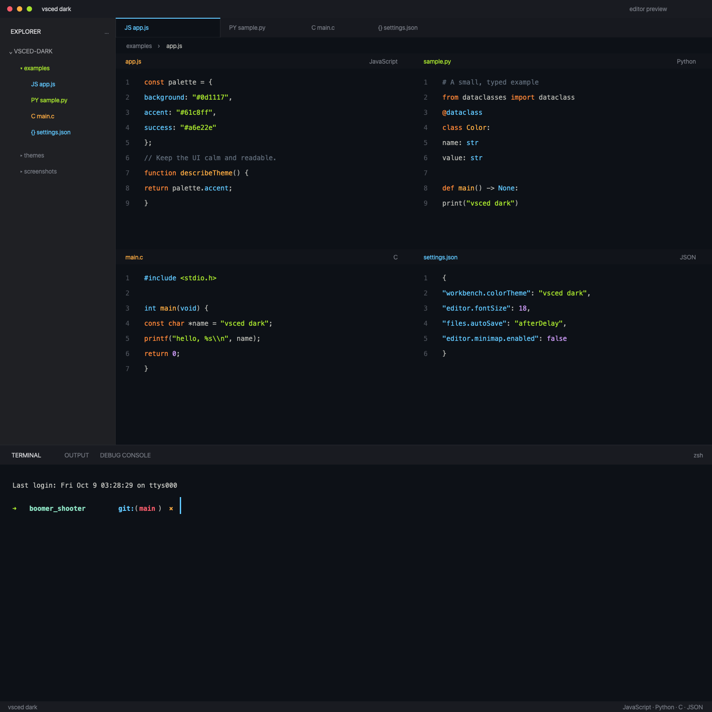

# vsced dark

A charcoal VS Code theme inspired by the supplied Zed editor reference. It brings the same restrained surfaces and high-contrast syntax accents to the editor, Explorer, terminal, and workbench.



## Features

- Near-black editor canvas with a muted charcoal workbench and Explorer.
- Cyan identifiers and properties, lime strings and new files, orange functions, coral control keywords, and lavender numbers.
- Syntax colors for every popular language and file format: JavaScript/TypeScript (JSX/TSX), Python, Java, C/C++, C#, Go, Rust, PHP, Ruby, Swift, Kotlin, Dart, Scala, Lua, Haskell, Elixir, Clojure, R, Julia, Perl, Objective-C, F#, Zig, shell/PowerShell/batch, SQL, HTML, CSS/SCSS/Less, Vue, Svelte, Astro, Markdown/MDX, JSON, YAML, TOML, XML, INI, `.env`, Dockerfile, Makefile, GraphQL, Terraform, Protobuf, LaTeX, diff/patch, git commit messages, log files, and more.
- Semantic highlighting colors that agree with the TextMate colors, so language servers (TypeScript, Pylance, rust-analyzer, C#, Java) don't shift the palette.
- Bracket pair colors drawn from the same palette.
- Explorer Git decorations for added, modified, untracked, renamed, and deleted resources.
- Coordinated ANSI terminal colors, cursor, and selection colors.
- Designed to pair with [Minimal Plus Theme](https://marketplace.visualstudio.com/items?itemName=nasermirzaei.vscode-minimal-plus-theme), the recommended file icon theme.

## Use the Theme

1. Install the `vsced dark` extension or open this repository in VS Code to develop it.
2. Open **Preferences: Color Theme** and select **vsced dark**.
3. For the matching file icons, install [Minimal Plus Theme](https://marketplace.visualstudio.com/items?itemName=nasermirzaei.vscode-minimal-plus-theme) and select its **vscode-minimal-plus-icon-theme** icon theme.

The workspace settings in this repository already select the recommended icon theme and include the Explorer and terminal layout preferences used for the preview.

## Palette

| Use                  | Color                 |
| -------------------- | --------------------- |
| Editor background    | `#0d1117`             |
| Workbench / Explorer | `#191b21` / `#1f2024` |
| Cyan                 | `#61c8ff`             |
| Lime                 | `#a6e22e`             |
| Orange               | `#ffad43`             |
| Coral                | `#f45b69`             |
| Lavender             | `#d3a0ff`             |
| Comments             | `#626e7c`             |

## Develop or Package

The theme definition is in `themes/vsced-dark-color-theme.json`. To package the extension locally, run this from the extension directory:

```sh
npx --yes @vscode/vsce package --no-dependencies
```

The VSIX is distributed under GPL-3.0-only and includes the Ayu Darker source attribution in `THIRD_PARTY_NOTICES.md`. Install the generated `.vsix` from the VS Code Extensions view using **Install from VSIX...**.
